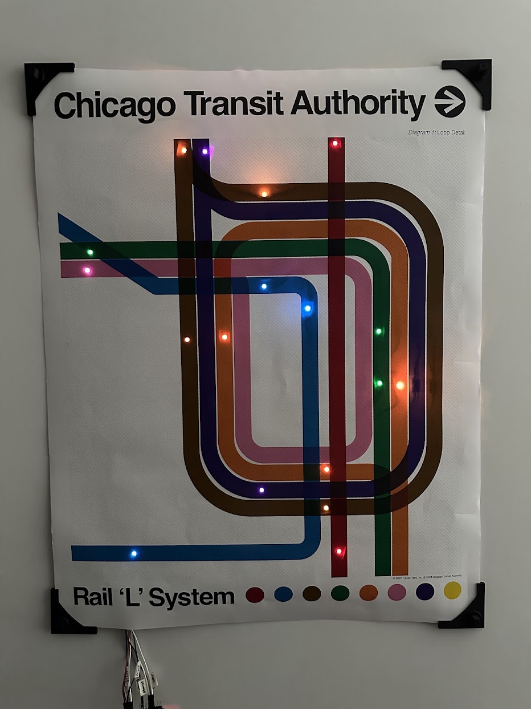

# CTA train tracker LED map

An ESP32 (MicroPython) drives one WS2812B strip per CTA "L" line, one LED per stop in the
Loop area. The board polls the CTA Train Tracker API itself and lights the stop each train
is approaching (the API's `isApp` flag) and keeps it lit until that train is approaching the
next one. Then the old LED fades out and the new one fades in.

For wiring, setup, file layout and how the lighting works, see [WIRING.md](WIRING.md).

## Stops covered
The strips cover the downtown Loop area, based on the
[Contemporary CTA Loop Poster](https://www.transittees.com/contemporary-cta-loop-poster/) by Transit Tees.

<table>
  <tr>
    <td align="center"></td>
    <td align="center"></td>
  </tr>
</table>

Each line has its own strip, so a shared station gets one LED per line.

🔴 **Red** · 5 stops  
Harrison → Jackson → Monroe → Lake → Grand

🔵 **Blue** · 7 stops  
UIC-Halsted → Clinton → LaSalle → Jackson → Monroe → Washington → Clark/Lake

🟢 **Green** · 5 stops  
Adams/Wabash → Washington/Wabash → State/Lake* → Clark/Lake → Clinton

🟤 **Brown** · 9 stops  
Merchandise Mart → Washington/Wells → Quincy/Wells → LaSalle/Van Buren → Harold Washington Library → Adams/Wabash → Washington/Wabash → State/Lake* → Clark/Lake

🩷 **Pink** · 9 stops  
Clinton → Clark/Lake → State/Lake* → Washington/Wabash → Adams/Wabash → Harold Washington Library → LaSalle/Van Buren → Quincy/Wells → Washington/Wells

🟠 **Orange** · 8 stops  
Quincy/Wells → Washington/Wells → Clark/Lake → State/Lake* → Washington/Wabash → Adams/Wabash → Harold Washington Library → LaSalle/Van Buren

🟣 **Purple** · 9 stops  
Merchandise Mart → Clark/Lake → State/Lake* → Washington/Wabash → Adams/Wabash → Harold Washington Library → LaSalle/Van Buren → Quincy/Wells → Washington/Wells

\* State/Lake is closed until 2029, so its LEDs stay dark.
