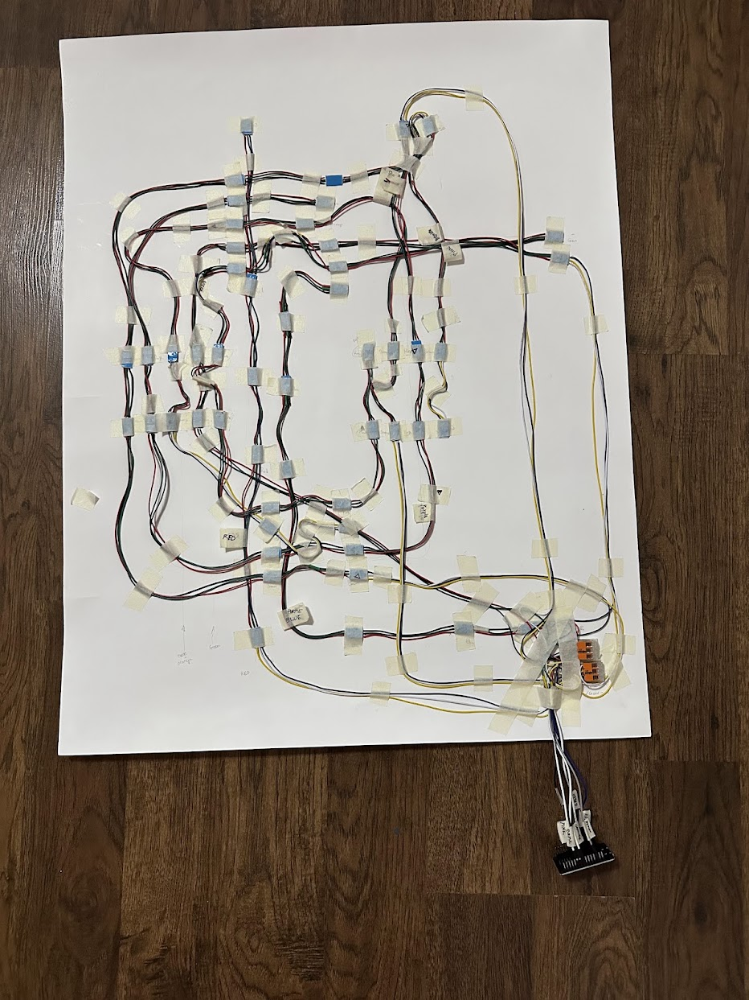

# Wiring, setup and technical notes

One WS2812B strip per CTA line, driven from an ESP32 DevKit V1.



## Power
- `main.py` sets the CPU to 80 MHz and holds the onboard blue LED (GPIO2) off. The red power LED is wired to 3.3V and can't be switched off in software.
- Strips run from 5V (VIN) with a common ground shared with the ESP32.
- Data lines are 3.3V logic straight from the GPIO pins; this works with short leads.
- `BRIGHTNESS` in `show.py` is 64/255 to keep current low on USB power. For higher brightness, use a separate 5V supply of at least 5A, with its ground tied to the ESP32's.

## Data pins
| Pin | Line | LEDs |
|-----|------|------|
| GPIO12 | red | 5 |
| GPIO13 | blue | 7 |
| GPIO14 | green | 5 |
| GPIO15 | brown | 9 |
| GPIO19 | pink | 9 |
| GPIO5 | orange | 8 |
| GPIO18 | purple | 9 |

52 LEDs in total. The strip's data-in end is LED 0.

## LED order
Stops by LED number on each strip (0 is the data-in end). This is the order in `LINE_STOPS` in `show.py`, which is not always the direction trains run (see the [README](README.md#stops-covered)).

- **Red:** 0 Harrison, 1 Jackson, 2 Monroe, 3 Lake, 4 Grand
- **Blue:** 0 UIC-Halsted, 1 Clinton, 2 LaSalle, 3 Jackson, 4 Monroe, 5 Washington, 6 Clark/Lake
- **Green:** 0 Adams/Wabash, 1 Washington/Wabash, 2 State/Lake, 3 Clark/Lake, 4 Clinton
- **Brown:** 0 LaSalle/Van Buren, 1 Harold Washington Library, 2 Adams/Wabash, 3 Washington/Wabash, 4 State/Lake, 5 Clark/Lake, 6 Merchandise Mart, 7 Washington/Wells, 8 Quincy/Wells
- **Pink:** 0 Clinton, 1 Clark/Lake, 2 State/Lake, 3 Washington/Wabash, 4 Adams/Wabash, 5 Harold Washington Library, 6 LaSalle/Van Buren, 7 Quincy/Wells, 8 Washington/Wells
- **Orange:** 0 Quincy/Wells, 1 Washington/Wells, 2 Clark/Lake, 3 State/Lake, 4 Washington/Wabash, 5 Adams/Wabash, 6 Harold Washington Library, 7 LaSalle/Van Buren
- **Purple:** 0 Merchandise Mart, 1 Washington/Wells, 2 Quincy/Wells, 3 LaSalle/Van Buren, 4 Harold Washington Library, 5 Adams/Wabash, 6 Washington/Wabash, 7 State/Lake, 8 Clark/Lake

To change a pin or an LED count, edit `STRIPS` and `STRIP_LEDS` in `show.py`, then push it over WiFi. Run `utils/show_chase_test.py` to check the LED order and each strip's real length.

## Setup
1. Request a Train Tracker key on the [CTA developer API application page](https://www.transitchicago.com/developers/traintrackerapply/), then copy `secrets.example.py` to `secrets.py`.
2. Flash MicroPython on the ESP32 (classic ESP32: write at offset `0x1000`).
3. Upload over USB, `secrets.py` first, then `main.py` (needs `pyserial`):
   ```
   python3 utils/push_verified.py secrets.py secrets.py
   python3 utils/push_verified.py main.py main.py
   ```
4. Restart the board (Ctrl-D over serial, or power-cycle), then push the show over WiFi:
   ```
   python3 utils/ota_update.py <board-ip> show.py
   ```

`python3 utils/ota_update.py <board-ip>` prints the status page; `scan` looks for the board.
Set `DEBUG = True` in `show.py` to print the lit stops each poll over serial.

## How it lights
- One `ttpositions` request covers all lines every `POLL_S` seconds (default 10; the CTA feed itself refreshes in about 20 s batches). If the API rejects 7 routes in one request (error 107), it splits into two requests of 4 and 3.
- Each train in the API has a next stop (`nextStaId`) and an `isApp` flag, set when Train Tracker
  shows it as "Approaching" or "Due". When a train is flagged, its next stop lights and stays lit
  (through arrival and departure) until that train is flagged approaching the following stop.
- Trains are tracked by run number, so several trains on a line, or trains in both directions at
  one stop, work. A stop is on while any train holds it. A train is forgotten (its RAM entry deleted) once it is flagged approaching a stop off the map, or when it leaves the feed.
- State is kept in RAM only: after a reboot or an OTA push the strips start dark and fill in as
  trains approach stops.
- State/Lake is closed until 2029, so its LEDs never light.

## Layout
| Path | Purpose |
|------|---------|
| `main.py` | Runs on the board: WiFi, OTA HTTP server, show loop, watchdog. Needs a USB push. |
| `show.py` | The show (fetch, tracking, fade). Updated over the air. |
| `secrets.py` | WiFi and API key. Not in git. Copy `secrets.example.py` and fill it in. |
| `WIRING.md` | This file. |
| `utils/ota_update.py` | Push `show.py` over WiFi, read status, scan for the board. |
| `utils/push_verified.py` | Push a file over USB with a SHA-256 check. |
| `utils/show_chase_test.py` | Chase test to check LED order and strip lengths. |

## Notes
- CTA route codes differ from line names: green `g`, brown `brn`, orange `org`, purple `p`.
- The API limit is 100,000 requests a day. One combined request every 5s is 17,280.
